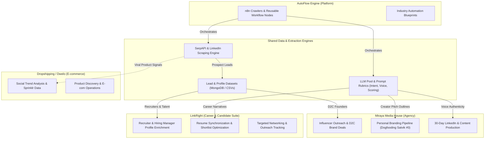

# Cross-Project Shared Capabilities & Data Flows

This document details how data models, extraction engines, and intelligence pipelines are shared across **AutoFlow**, **Miraya**, **LinkRight**, and **Dropshipping**.

## 1. Architectural Dependency Graph

## 2. Shared Assets Matrix

| Asset / Engine | Primary Producer | Consuming Projects | Usage in Consumer |
| :--- | :--- | :--- | :--- |
| **LinkedIn Profile Scraper** | LinkRight / `growth/linkedin_snippet` | Miraya & LinkRight | Founder discovery for Miraya; Recruiter profile intelligence for LinkRight. |
| **Lead Scoring & Intent Rubrics** | AutoFlow (`MIRAYA-EVAL-*`) | Miraya & LinkRight | Classifying prospect email replies (Miraya); evaluating recruiter messages (LinkRight). |
| **30-Day Authority Content Engine** | Miraya (`growth/30_day_engine`) | Miraya & Personal Branding | Agency inbound pipeline; personal brand dogfooding for Satvik (#0). |
| **Resume & Skill Parsers** | LinkRight (`resume_sync_engine`) | LinkRight & Miraya | Candidate shortlisting (LinkRight); internal agency hiring evaluations (Miraya `operations/hiring`). |
